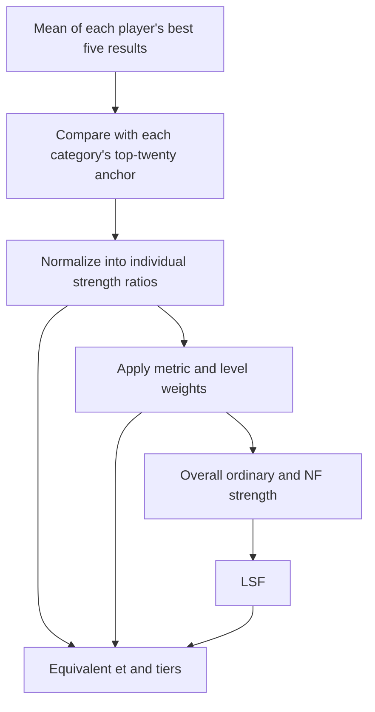

# top and LSF Rankings

**The top rankings use several strong performances; LSF puts different specialities on a shared scale.**

Some players excel at low times, others at high Bvs or Stnb. Some are strongest on Beginner, others on Expert. A single PB in one category cannot fully describe those differences. The top and LSF rankings preserve individual results while also providing a combined measure.

## Why the Best Five?

An exceptional result may reflect skill, a particularly favourable board, or both. Taking the **mean of your five best historical results** reduces the influence of one lucky game instead of letting one peak performance represent your ability.

Taking too many results would make filling and improving a record unnecessarily demanding. Five is a compromise between reducing luck and limiting the workload. It still measures strong performances, not your average over all games, and does not eliminate luck entirely.

Each category selects its own five results: the five lowest times, five highest Bvs values and five highest Stnb values. These need not come from the same replays, and repeated 3BV values are allowed.



## What Does top Include?

Beginner, Intermediate and Expert each have Time, Bvs and Stnb rankings, in both ordinary and NF categories: **18 rankings** in total.

| Code | Meaning |
| --- | --- |
| b, i, e | Beginner, Intermediate, Expert |
| t, b, s | Time, Bvs, Stnb |
| et | Mean of the five best Expert times |
| eb | Mean of the five best Expert Bvs results |

Only approved standard-mode replays that are not hidden for a tournament qualify. Minimum 3BV is **10 for Beginner, 30 for Intermediate and 100 for Expert**, for all three metrics.

Ordinary rankings include NF replays. NF rankings only include replays with zero effective right clicks. Each category selects its own best five, so a replay may contribute to both.

With fewer than five results, each missing Time result counts as **999.999 seconds**, and each missing Bvs or Stnb result counts as 0. The mean still divides by five. A player with at least one qualifying top replay participates in every category, using these defaults wherever results are missing.

## Anchors and Relative Strength

Raw metrics cannot simply be added: lower Time is better, higher Bvs and Stnb are better, and the three difficulty levels have different numerical ranges. Each ranking therefore has a high-level reference called an **anchor**.

An anchor is the **arithmetic mean of the top twenty players' best-five means** in that category. First average each player's five results, then average the twenty players, rather than taking the twenty best individual replays across the site. Different categories may have different top twenty players; ordinary and NF categories also have separate anchors.

Let `V` be a player's best-five mean and `A` the corresponding anchor. Individual strength ratios are:

| Metric | Strength ratio |
| --- | --- |
| Time | `A / V` |
| Bvs | `V / A` |
| Stnb | `(V / A)^(1/1.7)` |

Higher is always better, and **1 means matching that category's anchor**. The `1/1.7` power makes Stnb scale consistently with speed: on the same board, the same proportional speed increase produces the same proportional increase in all three strength ratios.

Anchors change as results improve or leave the rankings. Consequently, unchanged personal results can receive different strength scores, equivalent times or tiers. These are relative measures, not permanent absolute standards.

## From Individual Strength to LSF

Each level's strength is a weighted sum, using the following weights directly:

| Level | Time | Bvs | Stnb |
| --- | --- | --- | --- |
| Beginner | 28 | 48 | 24 |
| Intermediate | 34 | 34 | 32 |
| Expert | 33 | 33 | 34 |

For example: `Beginner strength = 28 × bt ratio + 48 × bb ratio + 24 × bs ratio`. Matching all three anchors gives a level strength of **100**.

Then combine the levels, followed by ordinary and NF strength:

```text
Overall strength = Beginner strength × 6 + Intermediate strength × 14 + Expert strength × 20
LSF = Ordinary overall strength × 0.97 + NF overall strength × 0.03
```

The three levels and overall strength are ranked separately for ordinary and NF play. Together with LSF, these form **9 derived rankings**. Matching every corresponding anchor gives overall strength and LSF values of **4000**.

LSF offers an overall comparison without replacing the underlying specialities. Two players can have the same LSF through different combinations of metrics and levels. Individual results and profile radar charts still provide useful context.

## Equivalent et: One Shared Scale

Comparing a level strength of 100 with an overall strength of 4000 is not intuitive. **Equivalent et** converts individual, level, overall and LSF strength onto the same Expert Time scale, so players with different specialities can discuss their ability using a common standard.

First normalize the strength: divide an individual ratio by 1, level strength by 100, or overall strength and LSF by 4000. Let the normalized result be `r`, and the corresponding et anchor be `A_et`:

```text
Equivalent et = A_et / r
```

**Ordinary categories and LSF use the ordinary et anchor; NF categories use the NF et anchor.** Tiers use the same reference selection. Strength ratios themselves still use their own metric-specific ordinary or NF anchors.

With an ordinary et anchor of 30 seconds, ordinary normalized strength 1 corresponds to an equivalent et of 30 seconds; 1.5 corresponds to 20 seconds; and 0.5 corresponds to 60 seconds. If the NF et anchor is 60 seconds, NF normalized strength 1 corresponds to an equivalent et of 60 seconds. Lower equivalent et means stronger performance.

Equivalent et is a rating scale, **not an actual Expert PB or a promise that a player can achieve that time**. A player who excels at Bvs, Stnb or Beginner can reach a strong equivalent et through those strengths.

## Tiers: Naming the Scale

Tiers divide equivalent et into the following intervals, with a stage number showing progress within each interval:

| Equivalent et E (seconds) | Tier |
| --- | --- |
| E > 100 | Novice |
| 60 < E <= 100 | Sapper |
| 55 < E <= 60 | Lesser Deity |
| 50 < E <= 55 | Greater Deity |
| 45 < E <= 50 | Lesser Archdeity |
| 40 < E <= 45 | Greater Archdeity |
| 35 < E <= 40 | Lesser Overgod |
| 30 < E <= 35 | Greater Overgod |
| E <= 30 | Alien |

Stages use **linear interpolation in strength, not in seconds**. The weaker end starts at 0, approaching 10 towards the stronger end, displayed to one decimal place, for example `Greater Archdeity 3.2`. Reaching a boundary moves the player into stage 0 of the stronger tier.

Alien starts at stage 0 at 30 seconds and reaches stage 10 at 25 seconds. Stronger results continue beyond stage 10. Zero strength is Novice 0.0, with infinite equivalent et.

The LSF table displays tiers in its eight strength columns and the extra column beside LSF. Table labels abbreviate Greater / Lesser to G. / L., for example `G. Archdeity 3.2`. Hover over a tier cell to see its full title and equivalent et. **Tiers only change the display, not strength-based ranking order.**
