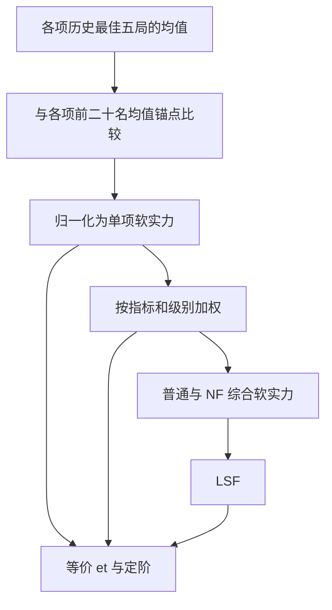

# top 榜与 LSF 榜

**top 榜看多局优秀表现，LSF 榜将不同专长放到同一尺度上评价。**

有人擅长低用时，有人擅长高 Bvs 或 Stnb；有人初级突出，有人高级更强。只看某一项 PB，很难完整描述这些玩家的水平。top 与 LSF 保留各项成绩的差异，再提供可以相互比较的综合评价。

## 为什么取 top5

一局特别好的成绩，既可能来自实力，也可能受益于特别合适的局面。取**历史最佳五局的均值**，是为了减少单局运气对评价的影响，而不是只用一次巅峰表现代表玩家。

但取的局数也不能太多，否则为了补齐或更新成绩，玩家需要投入过多时间。五局是在降低运气成分与控制玩家负担之间的折中。它仍然衡量优秀表现，不是所有对局的平均水平，也不能完全消除运气影响。

每个项目独立选取最佳五局：最低的五个 Time、最高的五个 Bvs、最高的五个 Stnb。它们可以来自不同录像，同一个 3BV 也可以多次入选。



## top 榜包含哪些成绩

初级、中级、高级各有 Time、Bvs、Stnb 三项，分普通与 NF 两类，共 **18 个小榜**。

| 缩写 | 含义 |
| --- | --- |
| b、i、e | 初级、中级、高级 |
| t、b、s | Time、Bvs、Stnb |
| et | 高级 Time 最佳五局的均值 |
| eb | 高级 Bvs 最佳五局的均值 |

只接收已通过审核、未处于比赛隐藏状态的标准模式录像。初级、中级、高级的 3BV 下限分别为 **10、30、100**，三项指标均适用。

普通榜包含 NF 录像；NF 榜只考虑有效右键次数为 0 的录像。两类独立选出五局，因此同一录像可以同时进入普通榜与 NF 榜。

不足五局时，缺少的 Time 按每局 **999.999 秒**补位，Bvs 和 Stnb 按 0 补位，仍除以 5。至少有一条合格 top 录像的玩家会参与全部项目；空缺项目也按上述规则计算。

## 锚点与软实力

不同指标的数值不能直接相加：Time 越小越好，Bvs、Stnb 越大越好，三级别的数值范围也不同。因此，先为每个小榜建立一个高水平参照，称为**锚点**。

每个锚点是对应小榜**前二十名玩家的 top5 均值的算术平均**。先算每个人的最佳五局均值，再算二十人的均值，而不是直接取全站最好的二十局。各项的前二十名可以是不同玩家，普通与 NF 也分别拥有自己的锚点。

设玩家某项 top5 均值为 `V`，该项锚点为 `A`，单项软实力为：

| 指标 | 单项软实力 |
| --- | --- |
| Time | `A / V` |
| Bvs | `V / A` |
| Stnb | `(V / A)^(1/1.7)` |

三项均为越大越好，**1 表示达到该项锚点水平**。Stnb 的 `1/1.7` 次方用于齐次化：相同局面下，速度提高相同比例时，三项软实力会提高相同比例。

锚点会随榜上成绩变化。因此，同一份个人成绩的软实力、等价 et 与定阶也可能变化；这些评价是相对于参照水平的，不是永久不变的绝对标尺。

## 从单项到 LSF

先按下表加权，得到每个级别的软实力。表内为直接相乘后相加的权重：

| 级别 | Time | Bvs | Stnb |
| --- | --- | --- | --- |
| 初级 | 28 | 48 | 24 |
| 中级 | 34 | 34 | 32 |
| 高级 | 33 | 33 | 34 |

例如：`初级软实力 = 28 × bt软实力 + 48 × bb软实力 + 24 × bs软实力`。三项都达到锚点时，单级别软实力为 **100**。

再汇总三级别，并合并普通与 NF：

```text
综合软实力 = 初级软实力 × 6 + 中级软实力 × 14 + 高级软实力 × 20
LSF = 普通综合软实力 × 0.97 + NF综合软实力 × 0.03
```

普通与 NF 均独立计算三级别及综合软实力，加上 LSF，共 **9 个派生小榜**。全部项目达到各自锚点时，综合软实力和 LSF 均为 **4000**。

LSF 提供综合比较，但不会抹去专长：同样的 LSF，可以来自不同的指标与级别组合。单项成绩和个人雷达图仍然值得一起看。

## 等价 et：统一评价尺度

直接看“初级软实力 100”和“综合软实力 4000”，不容易直观比较。**等价 et** 将单项、单级别及综合软实力换算成高级 Time 的秒数尺度，让不同专长的玩家可以用同一把尺子讨论水平。

先将软实力归一化：单项以 1 为基准，单级别以 100 为基准，综合以 4000 为基准。设归一化结果为 `r`，对应 et 锚点为 `A_et`，则：

```text
等价 et = A_et / r
```

**普通项目使用普通 et 锚点，NF 项目使用 NF et 锚点。** 定阶也沿用相同的参考选择。这不改变软实力本身使用各自指标的普通/NF 锚点的规则。

例如普通 et 锚点为 30 秒：普通项目归一化软实力为 1，对应等价 et 30 秒；为 1.5，对应 20 秒；为 0.5，对应 60 秒。如果 NF et 锚点为 60 秒，NF 项目归一化软实力为 1 时，等价 et 就是 60 秒。等价 et 越小，表示的实力越强。

等价 et 是评价尺度，**不是玩家真实的高级 PB，也不保证玩家能够扫出该用时**。擅长 Bvs、Stnb 或初级的玩家，同样可以凭自己的优势获得较强的等价 et。

## 定阶：把尺度变成称号

定阶将等价 et 划为以下区间，并用阶数表示区间内的进展：

| 等价 et E（秒） | 称号 |
| --- | --- |
| E > 100 | 新手 |
| 60 < E <= 100 | 工兵 |
| 55 < E <= 60 | 小雷神 |
| 50 < E <= 55 | 大雷神 |
| 45 < E <= 50 | 小雷圣 |
| 40 < E <= 45 | 大雷圣 |
| 35 < E <= 40 | 小雷帝 |
| 30 < E <= 35 | 大雷帝 |
| E <= 30 | 外星人 |

区间内按**软实力线性插值**，不是按秒数线性插值。弱端为 0 阶，接近强端时趋近 10 阶，保留一位小数，例如“大雷圣3.2阶”；到达分界点时进入更强称号的 0 阶。

外星人以 30 秒为 0 阶、25 秒为 10 阶，更强时继续外推，允许超过十阶。零软实力对应新手0.0阶，等价 et 为无穷大。

LSF 榜中，八个软实力列按这套规则显示定阶，LSF 本身仅显示数值。英文表格将 Greater / Lesser 简写为 G. / L.，悬停定阶单元格可查看完整称号及等价 et。**定阶只是展示方式，不会改变原有软实力排序。**
